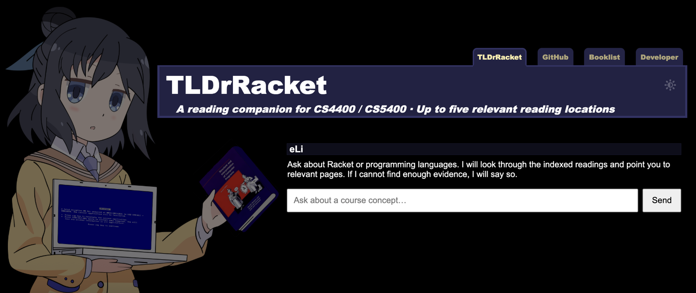

# TLDrRacket



[English](README.md) · [简体中文](README.zh-CN.md) · **日本語**

ノースイースタン大学の [CS4400 / CS5400: Principles of Programming Languages](https://pl.barzilay.org/) 向けの、小さな読書アシスタントです。自然言語で質問すると、インデックスに登録した教材に基づく回答と、**最大 5 か所の関連する本文へのリンク**を表示します。一致する箇所が少なければ出典も少なくなり、見つからない場合は回答を控えることを明示し、回答生成 API を呼び出しません。

Python、Flask、ローカルの Chroma、Gemini、既存の HTML/CSS/JavaScript フロントエンドで構成されています。フロントエンドのビルド工程、独立したデータベースサービス、エージェントフレームワーク、キューはありません。RAG アプリケーションの作り方を学ぶための、理解しやすいサンプルとしても使えます。

## クイックスタート

Python **3.12** を使用してください。以下のコマンドは、リポジトリのルートディレクトリで実行します。

```sh
python3.12 -m venv .venv
source .venv/bin/activate
python -m pip install -r requirements.txt
cp .env.example .env
```

`.env` を編集し、`GOOGLE_API_KEY` を設定します。標準の `KEY=value` 形式を使用するため、API キーだけが書かれた旧形式のファイルは変換が必要です。プロセスに設定済みの環境変数が優先されます。キーをフロントエンドのコードに含めないでください。

```sh
python index.py build
python webserver.py
```

[localhost:5000](http://127.0.0.1:5000) を開きます。最初のコマンドは埋め込み API を使用して永続インデックスを構築します。サーバーが自動で構築することはありません。インデックスがなくてもページと `/healthz` は読み込めますが、質問に回答するには、キーの設定と利用可能なインデックスが必要です。Gunicorn、systemd、Nginx、HTTPS の設定は、[Linux VPS ガイド](docs/deployment.md)を参照してください。

## RAG の仕組み

```text
PDF/テキスト → ページ抽出 → 重なりのあるチャンク → 埋め込み → ローカルの Chroma
質問 → 1 回のベクトル検索 → 距離による絞り込み → ページの重複除去 → 最大 5 件の抜粋
                                                                       ↓
                                                  Gemini の回答 + 同じ本文箇所へのリンク
```

1. `index.py` は `DATA_PATH` 配下の PDF と UTF-8 の `.txt` ファイルを読み込みます。PDF の各ページを 800 文字のチャンクに分割し、隣り合うチャンクに 80 文字の重なりを設けます。空のページはスキップします。スキャンした PDF は取り込み前に OCR 処理が必要です。
2. Chroma は埋め込みとメタデータを保存します。メタデータには相対ファイル名、0 始まりの PDF ページ番号、チャンク番号、コンテンツハッシュを含む安定した ID が入ります。コレクションでは明示的に**コサイン距離**を使用します。
3. `rag.py` は 1 回の検索で最大 20 件の候補チャンクを取得します。距離で絞り込み、ファイルとページの組み合わせごとに最も近いチャンクを選び、最大 5 件に制限します。これは 5 **か所**の本文を意味し、必ずしも 5 つの異なる文書ではありません。
4. 選ばれたチャンクだけを回答生成用のプロンプトに渡します。出典リンクとプレビューにも同じチャンクを使います。モデルには `[1]`、`[2]` などの形式で引用し、根拠が足りなければその旨を認めるよう指示します。
5. 条件を満たすチャンクがなければ、サーバーは回答生成モデルを呼び出さず、`status: "no_match"`、説明、`sources: []` を返します。ただし、質問の埋め込みには引き続き埋め込み API が必要です。

出典のレスポンスには、短い `preview` に加えて、取得した抜粋の全文が `content` として含まれます。改行とインデントも保持されます。`data/5400Notes.txt` のような `.txt` のノートでは `format` は `markdown`、PDF の抜粋では `text` になります。出典の下にある **Read excerpt** には元の文章が表示され、見出し、リスト、表、コードブロックにも対応します。Markdown の抜粋は最初から展開され、必要に応じて折りたためます。PDF のテキスト抜粋は必要なときに展開できます。これは回答に使用したものと同じ抜粋であり、ファイル全体や、モデルが追加で生成した要約ではありません。インデックスには長さを区切ったチャンクを保存するため、抜粋の先頭や末尾が Markdown の構文の途中になる場合があります。

UI は送信後すぐに待機アニメーションと経過時間を表示し、重複送信を防ぎます。成功時、失敗時、90 秒のタイムアウト時には入力欄を再び使える状態に戻します。PDF リンクには **1 始まりの PDF ページ番号**を使うため、紙面に印刷されたページ番号とは異なる場合があります。テキストの出典リンクは生のテキストファイルを開きます。展開できる抜粋を使えば、チャット内でも整形された文章を読めます。生成された Markdown はサニタイズされ、ユーザーの質問はテキストとして表示されます。

## 設定

[`.env.example`](.env.example) を参照してください。パスには絶対パスを指定できます。相対パスはプロセスの作業ディレクトリを基準に解決します。

| 変数 | 既定値 | 用途 |
| --- | --- | --- |
| `GOOGLE_API_KEY` | 必須 | サーバー側で使用する Gemini Developer API キー |
| `CHAT_MODEL` | `gemini-3.5-flash-lite` | 回答生成モデル |
| `EMBEDDING_MODEL` | `models/gemini-embedding-001` | インデックス構築と質問で共用する埋め込みモデル |
| `EMBEDDING_DIMENSIONS` | `768` | 埋め込みベクトルの次元数 |
| `DATA_PATH` | リポジトリ内の `data/` | PDF とテキストの教材 |
| `CHROMA_PATH` | リポジトリ内の `chroma/` | 永続化するローカルインデックス |
| `MAX_DISTANCE` | `0.35` | 許容するコサイン距離の最大値（**暫定値**） |
| `CANDIDATE_COUNT` | `20` | 絞り込みと重複除去の前に取得する候補チャンク数。範囲は 5–100 |
| `PROVIDER_TIMEOUT` | `30` | プロバイダーとの通信タイムアウト（秒）。最大 45 |
| `MAX_MESSAGE_LENGTH` | `2000` | 空でない質問の最大文字数 |

既定の設定は Gemini Developer API 向けであり、Vertex AI 向けではありません。過去のノートブックにある Gemini 1.5 Flash と `text-embedding-004` の識別子はすでに廃止されています。Google の[リリースノート](https://ai.google.dev/gemini-api/docs/changelog)と[廃止予定](https://ai.google.dev/gemini-api/docs/deprecations)を参照してください。既定のテキスト埋め込みモデルは引き続きサポートされており、このプロジェクトで統合をテストしているモデルです。埋め込みモデル、次元数、チャンク設定を変更した場合は、明示的な再構築が必要です。チャットモデルや距離のしきい値だけを変更した場合は不要です。

### 件数を埋めるのではなく、関連性を調整する

**コサイン距離が小さいほど、より近い一致を意味します。** `0.35` は調整の出発点であり、測定された信頼度や、どの場合にも正しいしきい値ではありません。このチェックアウトでは、この授業の教材に対して、実際の Gemini の埋め込みを使った較正は行っていません。

回答生成の料金を発生させずに、候補を確認できます。

```sh
python index.py probe "How do closures capture an environment?"
python index.py probe "What is the weather tomorrow?"
python index.py calibrate docs/retrieval-eval.json
```

`probe` は候補の距離、プレビュー、しきい値を満たすかどうかを出力します。ページの重複除去と最大 5 か所への制限は、その後に行われます。`calibrate` はラベル付きの各質問を 1 回ずつ埋め込み、0.05 から 0.80 までのしきい値を順に試します。授業に関する質問を正しく取得できた件数と取りこぼした件数、誤った出典に基づく回答になる件数、無関係なのに受け入れられる質問の件数を報告します。回答生成は行いません。

`docs/retrieval-eval.json` の初期ラベルを確認し、教科書などの妥当な別の出典も含めて、実際の教材に合わせて追加してください。授業の質問を拾いつつ、無関係な質問や誤った出典の受け入れを避けられるしきい値を選びます。調整に使っていない別の質問で確認し、必要なら中国語の質問も含めてください。その後、`MAX_DISTANCE` を設定してサービスを再起動します。この補助ツールが確認するのは、期待する出典が少なくとも 1 件取得されたかどうかです。表示するすべての出典や、生成された回答を採点するものではありません。

### 教材の更新とインデックスの移行

Web サービスを停止した状態で実行します。

```sh
python index.py build
```

変更のないチャンクは再利用し、変更されたチャンクと新しいチャンクは埋め込みを生成します。削除または編集した教材に由来する古いチャンクは削除します。`DATA_PATH` ディレクトリ全体が対象のコーパスになります。このディレクトリからファイルを削除すると、次回のビルド時に対応するインデックス内のチャンクも削除されます。

古いノートブックのインデックスを使用する場合や、埋め込み設定を変更した場合は、移行が必要です。まずインデックスをバックアップし、次を実行してください。

```sh
python index.py build --rebuild
```

置き換えるのは、このアプリケーションの `tldrracket` コレクションだけです。Markdown の空白保持に対応する前に構築したインデックスから更新する場合は、インデントされたコードを正しく保持できるよう、一度 `build --rebuild` を実行してください。書き込みが中断または失敗すると `.building` マーカーが残り、不完全なインデックスでの配信を防ぎます。[復旧手順](docs/deployment.md#recover-an-interrupted-build)を参照してください。更新が成功するたびにサーバーを再起動します。バックアップから復元する際は、データ、インデックス、モデル設定をそろえて復元してください。

## HTTP API

`Content-Type: application/json` を指定して `POST /api/ask` を呼び出します。

```json
{"message": "What is lexical scope?"}
```

正常なレスポンスには `response`、`status`（`ok` または `no_match`）、`sources` が含まれます。各出典には `id`、`file`、`page`（PDF は 1 始まり、テキストは `null`）、`url`、`preview`、`content`（取得したチャンクの全文）、`format`（`.txt` は `markdown`、PDF は `text`）、`distance` が含まれます。距離は診断用の値であり、信頼度スコアではありません。

| エンドポイント / ステータス | 意味 |
| --- | --- |
| `GET /healthz` | プロセスが稼働中。モデルは呼び出さない |
| `GET /readyz` | キーが設定済みで、互換性のある空でないインデックスを開ける。モデルは呼び出さない |
| `GET /documents/<filename>` | `DATA_PATH` 内の PDF またはテキスト教材を配信する |
| `400`, `413` | 質問が不正、またはリクエスト本文が大きすぎる |
| `429` | このプロセスですでに 2 件の質問を処理中、またはプロキシのレート制限 |
| `502`, `504` | プロバイダーの障害、空の回答、または検出されたプロバイダーのタイムアウト |
| `503` | インデックスまたは設定が未作成、非互換、空、または更新中 |

エラーには `{"error": "..."}` を使用します。API レスポンスはキャッシュしません。Nginx が独自のエラーページを返す場合もあり、UI は JSON 以外のエラーにも対応しています。準備状態の確認では、リモート API キーの有効性、クォータ、モデルの利用可否までは検証しません。ブラウザーがタイムアウトすると応答の待機は終わりますが、サーバーですでに実行中のプロバイダーへのリクエストがキャンセルされるとは限りません。

## ファイル構成と学習の手引き

- `index.py`: 文書の読み込み、チャンク分割、差分インデックス更新、候補の調査、しきい値の走査。
- `rag.py`: 共通設定、インデックスの互換性確認、検索、出典、回答生成。
- `webserver.py`: HTTP リクエストの検証、遅延初期化、同時処理数の制限、安全な文書配信。
- `static/index.html`, `static/chat.js`, `static/style.css`: 待機状態の表示と出典リンクを備えた既存のフロントエンド。
- `deploy/`: 本番用プロセスとリバースプロキシの設定例。
- `TLDrRacket.ipynb`, `evaluation.ipynb`: 参考用に残してある過去の実験。サポート対象の実行環境ではなく、再利用する前に依存関係とモデルの更新が必要です。旧評価では出典 ID をコンテキストとして使っていました。回答が根拠に忠実かを意味のある形で評価するには、実際の抜粋テキストを使う必要があります。

## 検証

実行時のテストには Python の標準ライブラリを使用します。テストフレームワークや API キーは不要です。

```sh
python -m unittest discover -s tests -v
```

テストには、決定的な**ローカルのテストベクトル**を使う実際の一時 Chroma コレクションと、分離されたプロバイダーの代替実装を使用します。コサイン距離による絞り込み、0〜5 件の検索結果、出典とコンテキストの一致、重複除去、インデックスの更新と移行、リクエストの検証、障害、パストラバーサルを検証します。実際のモデルによる回答品質を証明するものではありません。

任意のブラウザーテストには、開発環境にだけ Playwright が必要です。別のターミナルで `python webserver.py` を起動してから、次を実行します。

```sh
python -m pip install playwright
python -m playwright install chromium
python tests/browser_smoke.py
```

これらのテストはレスポンスを差し替えて、待機表示、重複送信、0/1/5 件の出典、タイムアウトやエラーからの復帰、Markdown の回答と出典の抜粋、サニタイズ、モバイル表示を検証します。

## 対象範囲と制約

これは単一ノードで動作する RAG のサンプルで、同時に処理できる質問は最大 2 件、データベースは永続化する組み込み型です。検索は近似的であり、距離のしきい値を設けても、無関係な文章を受け入れたり、有用な文章を除外したりする場合があります。プロンプトは根拠に基づく回答と番号付きの引用を促しますが、主張や引用を形式的に検証するものではありません。ブラウジング、リランキングモデル、チャット履歴の記憶、OCR サービス、教材の自動同期はありません。参照できる教材はインデックスに登録したファイルで決まり、現在の授業サイトの内容と一致するとは限りません。文書配信用のルートは `DATA_PATH` 内の教材をサイト訪問者に公開するため、このツールを通じて公開する意図のある教材を使用してください。

JavaScript の依存ライブラリは `static/vendor/` に同梱してバージョン管理しており、ライセンスと出典は [THIRD_PARTY.md](THIRD_PARTY.md) に記載しています。アプリケーションのコードには [MIT ライセンス](LICENSE)を適用しています。同梱の授業・教材アセットの著作権と利用条件は、それぞれの著作者に帰属します。
